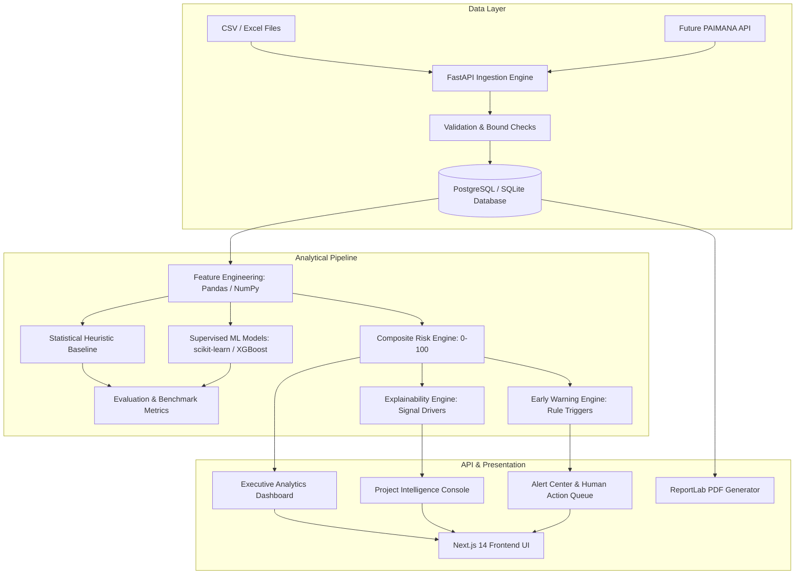
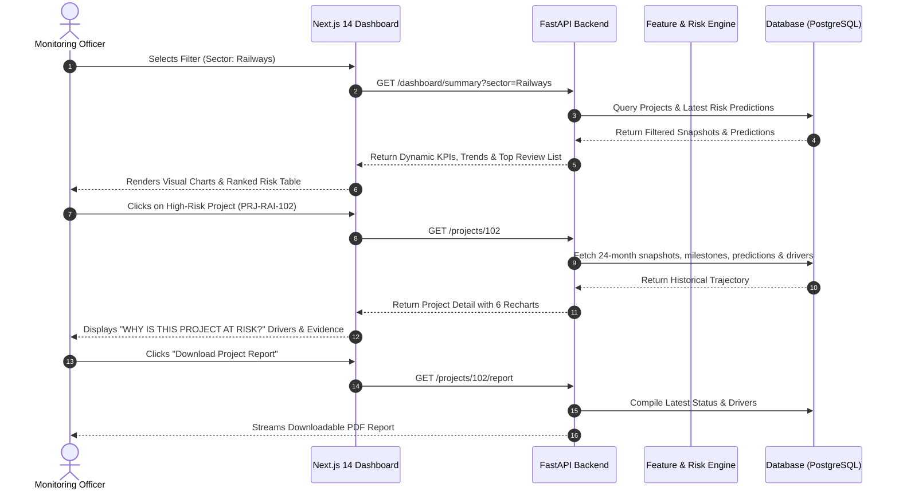
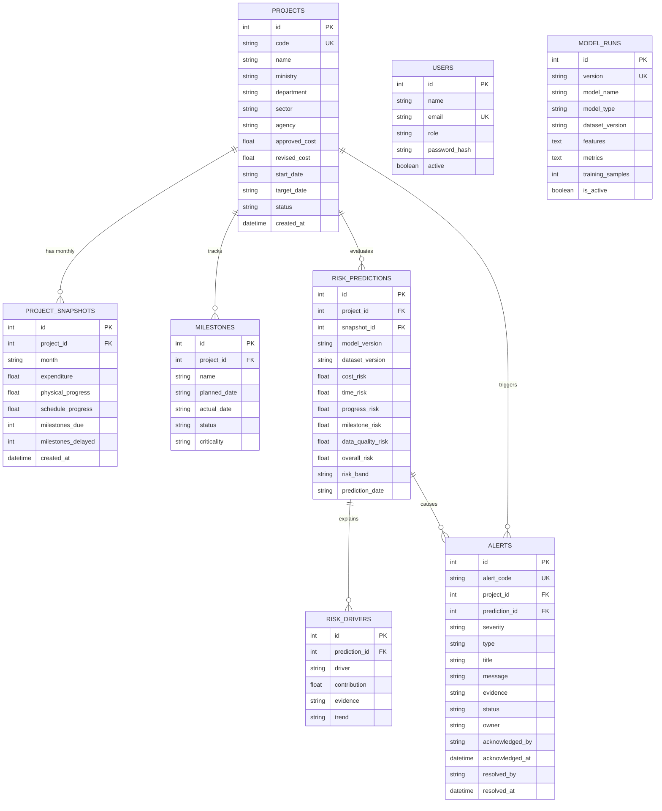

# PROJECT DRISHTI: Comprehensive Technical Documentation

**SIH Problem Statement**: SIH26103  
**Organization**: Ministry of Statistics and Programme Implementation (MoSPI)  
**Division**: Data Informatics & Innovation Division (DIID)  
**Project**: Infrastructure Project Intelligence & Early Warning System  

---

## 1. Architecture Diagram



---

## 2. Data-Flow Diagram



---

## 3. Database Entity Relationship (ER) Diagram



---

## 4. API Documentation Summary

| Method | Endpoint | Description |
|---|---|---|
| `POST` | `/auth/login` | Authenticates user and returns JWT bearer token |
| `GET` | `/auth/me` | Retrieves current authenticated profile & role |
| `GET` | `/dashboard/summary` | Real-time dynamic KPIs, risk distributions, trends, and top review projects |
| `GET` | `/projects` | Searchable project register with multi-column sorting and filters |
| `GET` | `/projects/{id}` | Project detail with snapshots, milestones, predictions, and drivers |
| `POST` | `/projects/{id}/predict` | Re-scores project live using current engineered indicators |
| `GET` | `/projects/{id}/report` | Streams ReportLab PDF intelligence report |
| `GET` | `/alerts` | Alert queue with severity, status, and type filtering |
| `POST` | `/alerts/{id}/acknowledge` | Human action: records officer acknowledgement |
| `POST` | `/alerts/{id}/resolve` | Human action: records resolution and closes alert |
| `GET` | `/analytics/overview` | Sector and agency risk distributions, status breakdowns, trigger frequencies |
| `GET` | `/analytics/benchmarks` | Direct comparison against sector medians and peer cohorts |
| `GET` | `/models/evaluation` | Model performance matrix comparing Baseline vs Supervised ML |
| `POST` | `/models/train` | Triggers chronological train/test split and trains models |
| `POST` | `/data/validate` | Validates uploaded CSV or Excel file structure and business constraints |
| `POST` | `/data/import` | Ingests validated data, recalculating all downstream signals |
| `GET` | `/admin/config` | Retrieves configurable risk policy weights and thresholds |
| `PUT` | `/admin/config` | Admin action: updates policy weights (sum = 1.0) and thresholds |
| `GET` | `/admin/audit-logs` | Chronological compliance audit log |
| `POST` | `/assistant/query` | Local offline analytical assistant query endpoint |

---

## 5. Model Card

### Objective
Predict emerging cost escalation and schedule slippage 3 months ahead based exclusively on indicators available up to snapshot month $T$.

### Input Features (18 Engineered Signals)
- **Cost**: `expenditure_ratio`, `revised_approved_ratio`, `monthly_expenditure_change`, `financial_progress`.
- **Progress Velocity**: `physical_progress`, `progress_delta`, `progress_slope_3m`.
- **Schedule**: `schedule_progress`, `progress_gap` (schedule - physical), `elapsed_percentage`, `slippage_days`.
- **Milestones**: `milestone_delay_rate`, `delayed_milestone_count`, `critical_delayed_count`.
- **Benchmarking**: `sector_median_gap`, `peer_ratio`.
- **Data Quality**: `missing_rate`, `data_update_age`.

### Evaluated Models
1. **Statistical Heuristic Baseline**: Threshold rule (`progress_gap > 8%` OR `slippage_days > 20`).
2. **Logistic Regression**: Linear probability classifier with standard scaling.
3. **Ridge Regression**: Regularized linear regression targeting continuous risk score.
4. **Random Forest**: 100-tree bagged ensemble.
5. **Gradient Boosting / XGBoost**: 80-estimator boosted decision trees.

### Evaluation Metrics
- **Classification**: Precision, Recall, F1-Score, PR-AUC, Calibration (1 - Brier Score).
- **Regression**: Mean Absolute Error (MAE), Root Mean Squared Error (RMSE).

---

## 6. Automated Test Report

The automated test suite in `backend/tests/` verifies all critical system layers:

```
collected 11 items

backend/tests/test_api_endpoints.py ........                             [ 72%]
backend/tests/test_features.py .                                         [ 81%]
backend/tests/test_pipeline_e2e.py .                                     [ 90%]
backend/tests/test_risk_engine.py .                                      [100%]

======================= 11 passed in 5.63s =======================
```

- **Data Integrity Check**: Zero NaN values in feature matrix.
- **Leakage Prevention**: Strictly chronological 70/30 split.
- **Composite Risk Bounds**: Score normalized strictly within [0.0, 100.0].
- **End-to-End Test**: DB seed → feature engineering → ML evaluation → risk calculation → explainable driver generation → early warning trigger → human acknowledgement → PDF report generation.

---

## 7. SIH 5–7 Minute Demonstration Script

### Act 1: The Core Question (0:00 – 0:45)
- Open `http://localhost:3000/dashboard`.
- **Speaker Point**:
  > *"Respected Jury Members, traditional project monitoring dashboards only tell us what has happened in the past — costs already spent and schedules already delayed.  
  > Project Drishti answers the question MoSPI and monitoring agencies actually care about:  
  > WHAT is happening, WHAT is likely to happen next, WHY the project is at risk, and WHICH projects should be reviewed first."*
- Highlight the **"DEMO MODE — SYNTHETIC DEMONSTRATION DATASET"** banner, establishing ethical data integrity.

### Act 2: Dynamic KPIs & Top 10 Action Queue (0:45 – 1:45)
- Point to the 5 live KPI cards (Total Projects, High/Critical Risk, Cost Risk, Time Risk, Active Alerts).
- Show the 12-month progress velocity trend line.
- Scroll to **Row 3: Top 10 Infrastructure Projects Requiring Urgent Review**.
- Explain how projects are dynamically ranked by multi-factor composite risk index.
- Demonstrate filter responsiveness: Select **Sector: Railways** — observe the entire dashboard update instantly.

### Act 3: Deep Project Intelligence & Explainability (1:45 – 3:00)
- Click on a High-Risk project (e.g. `PRJ-ROA-102` or `PRJ-RAI-102`).
- Show the 6 Risk Cards (Overall, Cost, Time, Progress, Milestone, Data Quality).
- **Point to the EXPLAINABILITY section**:
  > *"Notice we never simply say 'AI says high risk'. We explain the auditable evidence: +18 points contribution from 3 critical milestones overdue, and +15 points from financial expenditure outpacing physical execution by 18.4%."*
- Scroll through the **6 Interactive Longitudinal Recharts** demonstrating physical vs financial divergence.
- Click **"Download Project Report"** to show instant PDF brief generation via ReportLab.

### Act 4: 2D Risk Heatmap Matrix (3:00 – 3:45)
- Navigate to `/risk-heatmap`.
- Explain the 4 quadrants:
  - Top-Right: Critical Dual Escalation (High Cost & High Time).
  - Bottom-Left: Safe Operational Envelope.
- Hover over bubbles to show live project details; click a bubble to navigate.

### Act 5: Early Warning Alert Center & Human Action (3:45 – 4:30)
- Navigate to `/alerts`.
- Show how the Early Warning Engine flagged projects with specific triggers (Cost Escalation, Progress Stagnation, Milestone Overdue).
- Click **"Acknowledge"** on an alert — observe the status change to *Acknowledged* with the officer's name and timestamp recorded in the audit trail.

### Act 6: Model Evaluation & Anti-Leakage Safeguards (4:30 – 5:15)
- Navigate to `/model-evaluation`.
- Show the **Model Performance Comparison Matrix**.
- Explain the chronological 70/30 split that eliminates future lookahead bias.
- Click **"TRAIN MODELS"** to demonstrate live execution of the scikit-learn pipeline.

### Act 7: Architecture & Data Ingestion (5:15 – 6:00)
- Navigate to `/data-import`.
- Demonstrate the ingestion gateway: Upload a new monthly monitoring CSV.
- Show the instant Pre-Ingestion Validation Report (bounds check, date checks, duplicate detection).
- Click **"Confirm & Ingest Batch"** — show how features, predictions, and alerts are recalculated in one click.

### Closing:
> *"Data → Indicators → Prediction → Explanation → Early Warning → Human Action.  
> Project Drishti provides smart automation and actionable foresight for India's infrastructure mission."*
